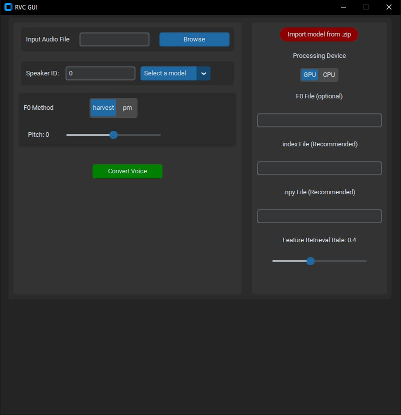

<div align="center">

<h1>RVC GUI<br><br>

For audio file inference only

<br>

</div>

A small, simple desktop GUI for converting audio files with RVC (Retrieval-based Voice Conversion) models,
based on [Tiger14n/RVC-GUI](https://github.com/Tiger14n/RVC-GUI). This version keeps the same simple layout
and adds better pitch tracking, a max quality mode and a batch converter.

## GUI



## What's new in this version

* **RMVPE pitch tracking** (now the default). Far fewer octave errors than dio / pm / harvest,
  where the converted voice suddenly drops an octave on breathy or creaky parts.
  `rmvpe.pt` (~180 MB) is downloaded automatically the first time it is used.
* **Fix octave drops**: a guard that repairs stretches where any pitch tracker locked onto
  half the real pitch. The console reports how much it corrected.
* **Max quality (slower)**: conversions are not real-time, so this trades speed for quality:
  * full precision (fp32) instead of the half precision picked for most GPUs,
  * RMVPE + crepe pitch tracks merged (averaged where they agree, octave slips rejected),
  * the `.index` feature search looks through 64 clusters instead of 1,
  * more context around each chunk and bigger chunks (files under 100 s are converted in one piece).

  Expect roughly 2-4x longer conversions. Sized for a 12 GB GPU.
* **Protect consonants/breaths** (from upstream RVC, default 0.33): keeps s/t/k sounds and breaths
  from turning metallic. 0.5 = off.
* **Volume envelope mix** (from upstream RVC, default 1 = off): lower values make the output
  follow the loudness of the input.
* **Clipping guard**: loud results are scaled down slightly instead of clipping when saved.
* **Batch conversion** of whole folders with `RVC-Batch.bat` / `rvc_batch.py` (see below).
* The window sizes itself to fit its contents (no more cut-off right panel on scaled displays).

## Preparing the environment

* Install Python 3.9 (3.8-3.10 should work) if you have not.
* Execute these commands (Windows with an Nvidia card):

```bash
python -m pip install -U pip setuptools wheel
pip install -U torch torchaudio --index-url https://download.pytorch.org/whl/cu118
pip install -r requirements.txt
```

* Download [hubert_base.pt](https://huggingface.co/lj1995/VoiceConversionWebUI/resolve/main/hubert_base.pt)
  and place it in the root folder.
* Put `ffmpeg.exe` in the root folder or on your PATH.
* `rmvpe.pt` downloads itself on first use. To place it manually, get it from
  [here](https://huggingface.co/lj1995/VoiceConversionWebUI/resolve/main/rmvpe.pt) and put it in the root folder.

Start the GUI with:

```bash
python rvcgui.py
```

or run `RVC-GUI.bat` (it uses a bundled `runtime\python.exe` if there is one, otherwise the system Python).

## Loading models

Use the import button to import a model from a zip file:

* The .zip must contain the ".pth" weight file.
* The .zip is recommended to contain the feature retrieval file ".index".

Or place the model manually in `models/`:

```
models
├───Person1
│   ├───xxxx.pth
│   └───xxxx.index
└───Person2
    ├───xxxx.pth
    └───...
```

## Recommended settings

| Setting | Recommended | Notes |
|---|---|---|
| F0 method | rmvpe | With Max quality on, rmvpe is merged with crepe automatically. |
| Fix octave drops | on | Turn off for a line that really is meant to jump down an octave. |
| Max quality | on | Turn off for quick previews. |
| Protect consonants/breaths | 0.33 | Lower if breaths still sound robotic, 0.5 to disable. |
| Feature retrieval rate | 0.4-0.75 | Higher = closer to the model's timbre, but can add artifacts. |
| Volume envelope mix | 1 (off) | Try 0.25-0.5 to keep the input's dynamics. |

## Batch conversion

Open `RVC-Batch.bat` in a text editor and fill in the settings at the top (model folder name, input folder,
pitch, quality...). Then double-click it, or drag a folder of audio files onto it. Leave `MODEL` empty
and run it once to list the available model names.

It converts every audio file in the folder (subfolders included), keeps the same file names and structure,
skips files that are already converted, and writes a `batch_log.csv`. At the end it lists the files where the
octave guard had to repair the pitch, so you know which ones to give a listen.

Or call the script directly:

```bash
python rvc_batch.py --list-models
python rvc_batch.py --model MyVoice --input D:\lines --output D:\lines_converted --pitch -3
python rvc_batch.py --help
```

Useful options: `--quality max|normal`, `--method rmvpe|hybrid|harvest|crepe|...`, `--index-rate`,
`--protect`, `--rms-mix`, `--octave-fix down|both|off`, `--sr model|source|44100`, `--overwrite`, `--cpu`.

## Credits

* GUI: [Tiger14n/RVC-GUI](https://github.com/Tiger14n/RVC-GUI)
* Voice conversion, RMVPE, protect and volume envelope code:
  [RVC-Project/Retrieval-based-Voice-Conversion-WebUI](https://github.com/RVC-Project/Retrieval-based-Voice-Conversion-WebUI) (MIT)
* crepe pitch tracking: [torchcrepe](https://github.com/maxrmorrison/torchcrepe)
